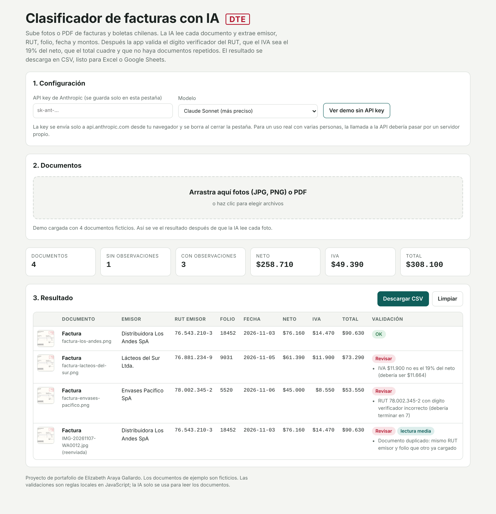
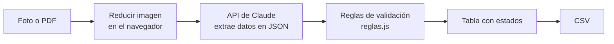

# Clasificador de facturas con IA

Aplicación web que lee fotos o PDF de facturas y boletas chilenas con inteligencia artificial, extrae sus datos y **valida automáticamente** que estén correctos antes de registrarlos.



**[Ver la demo en vivo](https://TU-USUARIO.github.io/clasificador-facturas-ia/)**: el botón "Ver demo sin API key" carga documentos de ejemplo sin necesidad de una cuenta.

## El problema

En una cadena con varias sucursales, las facturas y boletas llegan como fotos por WhatsApp y alguien tiene que digitarlas una por una. Los errores más comunes son:

- documentos reenviados que se registran dos veces;
- facturas con el IVA mal calculado;
- RUT mal escritos;
- totales que no cuadran.

Este proyecto nace de ese trabajo real de digitación.

## Qué hace

1. **Lee el documento con IA**: envía la imagen o el PDF a la API de Claude (Anthropic), que devuelve en JSON el tipo de documento, el emisor, el RUT, el folio, la fecha y los montos.
2. **Valida con reglas fijas**, sin IA, para que el resultado sea predecible:
   - dígito verificador del RUT (módulo 11);
   - IVA igual al 19% del neto (tolerancia de ±$2 por redondeo);
   - total = neto + IVA + exento;
   - documentos duplicados (mismo RUT emisor y folio, aunque el folio tenga ceros a la izquierda);
   - campos obligatorios que falten.
3. **Resume y exporta**: muestra totales y estados (OK / Revisar) y descarga todo en CSV, listo para Excel o Google Sheets.

## Cómo funciona



La IA se usa **solo para leer**. Las decisiones (si algo está bien o mal) las toman funciones de JavaScript que se pueden probar, en lugar de dejarlas a la IA.

## Tecnologías

- HTML, CSS y JavaScript sin frameworks: es un solo archivo, sin instalación.
- API de Claude (Anthropic) con visión, para imágenes y PDF.
- Node.js (`node:test`) para las pruebas automatizadas de las reglas.

## Cómo usarlo

1. Abre `index.html` en el navegador, o la demo en GitHub Pages.
2. Pega tu API key de Anthropic. Se guarda solo en la pestaña (`sessionStorage`) y se borra al cerrarla.
3. Arrastra fotos o PDF de facturas.
4. Revisa las observaciones y descarga el CSV.

> **Nota de seguridad:** para un uso real con varias personas, la llamada a la API debería pasar por un servidor propio (por ejemplo, una función serverless) para no exponer la key en el navegador.

## Pruebas

```bash
npm test
```

Las pruebas (`tests/reglas.test.js`) verifican:

- el cálculo del dígito verificador;
- la lectura de montos en formato chileno (`$1.234.567`);
- que se detecte el IVA mal calculado, el total que no cuadra y los duplicados.

## Estructura

```
index.html          interfaz y llamada a la API
reglas.js           reglas de validación (funciones puras)
tests/              pruebas automatizadas
ejemplos/           facturas ficticias para la demo
docs/               capturas
```

## Próximas mejoras

- Detectar notas de crédito y relacionarlas con la factura que anulan.
- Conciliar transferencias bancarias con facturas pendientes.
- Enviar los datos directo a Google Sheets (ver el proyecto hermano con n8n).

## Autora

**Elizabeth Araya Gallardo**, estudiante de Ingeniería en Informática (AIEP, Valparaíso), digitadora y automatizadora de procesos administrativos.

Los documentos de ejemplo son ficticios: las empresas, RUT y montos fueron inventados.
